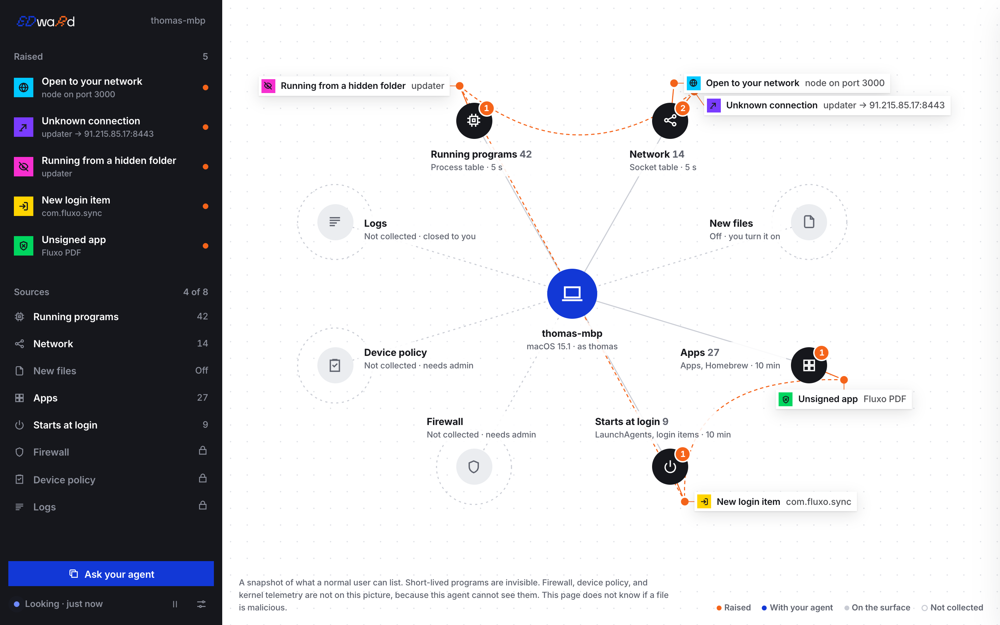
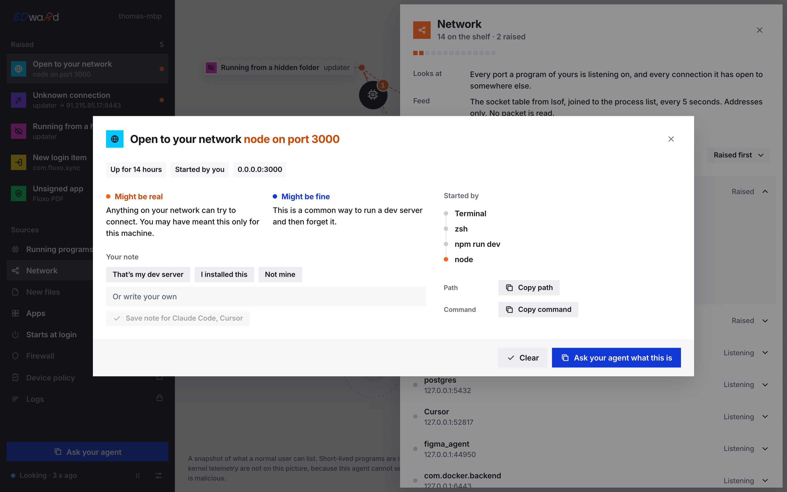

# EDwaRd

<p align="center">
  
</p>

EDwaRd is a local attack-surface picture of this Mac. One Go process, running as the installing user, lists what that user can already see: processes, listeners, installed apps, and startup items. It writes those facts to a JSON store, serves a page at [http://127.0.0.1:43393](http://127.0.0.1:43393), and, when asked, an agent reads that store.

It is not an antivirus. It has no kernel sensor, no signatures, no blocking, and no cloud. After install it makes no outbound connection. A callout is not a malware verdict.

## Just install

```bash
make mock && make app && sh install.sh
```

Opens [http://127.0.0.1:43393](http://127.0.0.1:43393). macOS, Node, and Go. No sudo.

<p align="center">
  
</p>

## Install

Read [install.sh](install.sh) first. The script copies a local `EDwaRd.app` (from `EDWARD_BUNDLE` or `./EDwaRd.app`) into `~/Library/Application Support/EDwaRd`, writes a user LaunchAgent (`com.edward.agent`), links `~/.local/bin/edward`, and opens the page. No password, no token. There is no checksum file in this tree, so the script does not download a binary.

| Step | What happens |
| --- | --- |
| `make mock` | Builds the page into `mock/dist` |
| `make app` | Embeds the page and builds `EDwaRd.app` |
| `sh install.sh` | Installs the LaunchAgent and opens the page |

If `127.0.0.1:43393` is already taken, install stops. It does not pick another port.

On a machine with no browser:

```bash
ssh -L 43393:127.0.0.1:43393 user@host
```

### Agent skill

The first-run page can write a skill for the agents you pick (Cursor, Claude Code, Codex, OpenClaw). Default is to ask first. Skip leaves the page working and writes no agent file.

<p align="center">
  
</p>

If you accept, it may write:

- Cursor: `~/.cursor/skills/edward/SKILL.md` only
- Claude Code: `~/.claude/CLAUDE.md` (sentinel block) and `~/.claude/skills/edward/SKILL.md` <!-- repo-leak:ok EDwaRd skill install path -->
- Codex: `~/.codex/AGENTS.md` (sentinel block) and `~/.codex/skills/edward/SKILL.md`
- OpenClaw: `~/.openclaw/skills/edward/SKILL.md` only

It does not write project `CLAUDE.md`, project `AGENTS.md`, or `.cursor/rules`.

Later, when a release and a checksum file exist:

```bash
curl -fsSL https://raw.githubusercontent.com/OWNER/edward/main/install.sh | sh
```

Replace OWNER with the GitHub account that hosts this repo. Windows will use `install.ps1`. That script is not in this build.

## What you see

Eight sources around the host. Each hub shows how many items were collected. The graph draws raised and asked findings as callouts. Open a hub for the full list; that list is still in the store.

Drag to pan. Scroll to pan. Pinch, or Ctrl/Cmd and scroll, to zoom. Double-click empty space to reset.

<p align="center">
  
</p>

Each callout has two readings: why it might matter, and why it might be fine. You decide. Clear it, ask an agent about it, or leave it raised.

<p align="center">
  
</p>

One example: `node` listening on `0.0.0.0:3000` for 14 hours, started from Terminal.

- Might matter: anything on this network can try to connect. You may have meant this only for this machine.
- Might be fine: a common way to run a dev server and then forget it.

## How it works

Collectors run on a timer, as you, with fixed argument lists and timeouts. No shell. Command lines are redacted before they are stored. Processes are grouped by name and path, so twenty copies of the same binary are one row.

A six-rule playbook in Go evaluates each snapshot. The same snapshot produces the same findings.

1. Open to your network: listening on an address that is not loopback.
2. Unknown connection: outbound to a raw IP, on a port other than 22, 53, 80, or 443.
3. Running from a hidden folder: a path segment that starts with `.`.
4. Unsigned app: a `.app` bundle that `codesign` reports as unsigned or ad-hoc.
5. New login item: a startup item that was not on the first successful baseline.
6. Disguised file: a name with two extensions whose last one looks executable, and that was not on the first successful files baseline.

The page polls `GET /api/store`. It does not scan the machine. Until you ask, the agent is told only that EDwaRd exists, that the page is on port 43393, and where the skill is. When you ask something like "anything sketchy on my laptop?", the agent reads the store and answers "EDwaRd has this, this, and that."

## What it collects

| Source | When | What |
| --- | --- | --- |
| Running programs | every few seconds | name, path, parent, uptime, for this user |
| Network | a short interval | TCP/UDP listeners and outbound sockets |
| Apps | every 10 minutes | `/Applications`, `~/Applications`, Homebrew; version and signature |
| Starts at login | every 10 minutes | user LaunchAgents and login items |
| New files | every minute, off by default | names, sizes, times in Downloads, Desktop, and `/tmp` |

Firewall, device policy, and logs stay empty on this picture. This agent cannot see them.

Never collected: environment variables, SSH private keys, keychains, browser profiles, mail, documents, password-manager vaults, `/etc/shadow`, packet contents, kernel telemetry.

## Pause and uninstall

Pause is on the page (Looking / Paused). Pause stops collectors. Resume runs them.

```bash
sh uninstall.sh
```

Read [uninstall.sh](uninstall.sh) first. Uninstall stops EDwaRd's process by binary path, removes the LaunchAgent and plist, deletes `~/Library/Application Support/EDwaRd` (the store and notes), removes `~/.local/bin/edward`, removes the sentinel blocks from `~/.claude/CLAUDE.md` and `~/.codex/AGENTS.md` only, and deletes the `edward` skill directories. Running it again succeeds. <!-- repo-leak:ok EDwaRd uninstall paths -->

It does not touch project files, other skills, other LaunchAgents, the firewall, chat transcripts, or macOS privacy grants.

Check the machine is clean:

```bash
launchctl print "gui/$(id -u)/com.edward.agent"
test ! -e ~/Library/LaunchAgents/com.edward.agent.plist
test ! -e "$HOME/Library/Application Support/EDwaRd"
test ! -e ~/.local/bin/edward
test ! -d ~/.cursor/skills/edward
test ! -d ~/.claude/skills/edward  # repo-leak:ok EDwaRd skill path
test ! -d ~/.codex/skills/edward
test ! -d ~/.openclaw/skills/edward
grep -n "edward:start\|edward:end" ~/.claude/CLAUDE.md ~/.codex/AGENTS.md  # repo-leak:ok EDwaRd sentinel
curl -sf --max-time 2 http://127.0.0.1:43393/ ; echo "page exit $?"
lsof -nP -iTCP:43393 -sTCP:LISTEN
```

`launchctl print` does not find the service. `grep` prints nothing. `curl` fails to connect. `lsof` prints nothing, or it prints a program that is not EDwaRd.

## License

The license is not chosen yet.

## In this repo

| Path | Role |
| --- | --- |
| `internal/` | Collector, redaction, playbook, store, localhost server |
| `schema/store.schema.json` | Store schema |
| `mock/` | Page |
| `skill/edward/SKILL.md` | Skill template |
| `install/` | User LaunchAgent |
| `media/mock/` | Fixture screenshots for this README |
