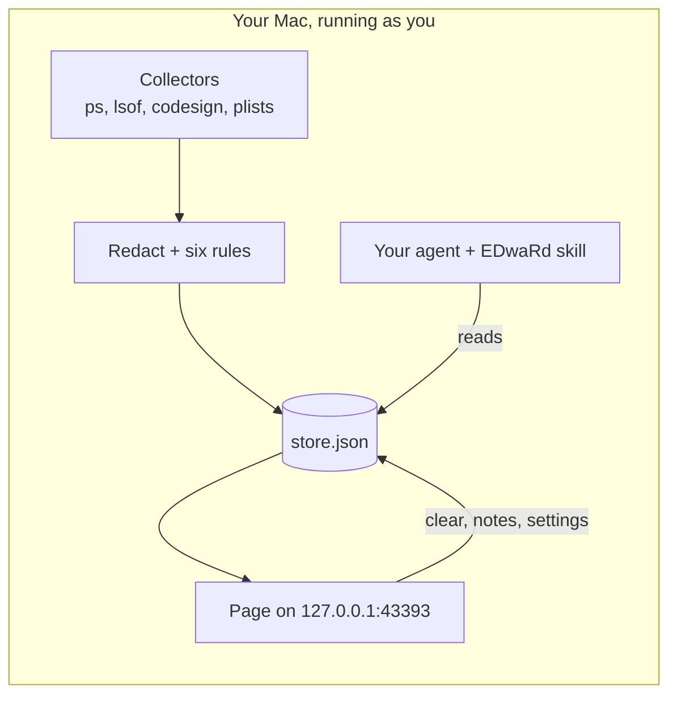

# EDwaRd

<p align="center">
  
</p>

EDwaRd shows what is running, listening and starting at login on your Mac, and lets your coding agent answer questions about it. One Go program runs as you, writes what it sees to a local JSON file, and serves a page at [http://127.0.0.1:43393](http://127.0.0.1:43393). Ask your agent "anything sketchy on my laptop?" and it answers from that file.

## Install

```bash
curl -fsSL https://raw.githubusercontent.com/LlamzonAmazon/edward/main/install.sh | sh
```

macOS 13 Ventura or later, Apple Silicon or Intel. No sudo, no password, no account. The app is ad-hoc signed and not notarized by Apple, so install it with the command above: Gatekeeper blocks a copy downloaded in a browser.

The script downloads the latest release, checks its SHA-256 against the release's `SHA256SUMS`, installs `EDwaRd.app` to `~/Library/Application Support/EDwaRd`, adds a login item, links `~/.local/bin/edward`, and opens the page. Read [install.sh](install.sh) first if you want to see each step.

On first run the page asks which agents to give the skill to. Skip it and the page still works.

<p align="center">
  
</p>

## What it does

EDwaRd lists what a normal user on this Mac can already see, every few seconds:

| Source | How often | What |
| --- | --- | --- |
| Running programs | every 5 seconds | name, path, parent, uptime, for your user |
| Network | every 15 seconds | TCP and UDP listeners, and inbound and outbound connections |
| Apps | every 10 minutes | `/Applications`, `~/Applications`, Homebrew; version and code signature |
| Starts at login | every 10 minutes | your LaunchAgents in `~/Library/LaunchAgents` |
| New files | every minute, off until you turn it on | names, sizes and times in Downloads, Desktop and `/tmp` |

Six rules raise findings from each snapshot:

1. **Open to your network:** a program listening on an address other than loopback. A program's UDP sockets on temporary ports become one finding when the running process passes a signature check for Apple or Developer ID code; any other UDP socket is raised on its own. A socket bound to an address the Mac no longer has raises nothing.
2. **Unknown connection:** an outbound connection to a raw IP, on a port other than 22, 53, 80 or 443.
3. **Running from a hidden folder:** a path with a segment that starts with `.`.
4. **Unsigned app:** an app that `codesign` reports as unsigned or ad-hoc signed.
5. **New login item:** a startup item that was not there on the first scan.
6. **Disguised file:** a name with two extensions whose last one is executable, such as `invoice.pdf.app`.

Each finding shows why it might matter and why it might be fine. You clear it, leave it raised, or ask your agent about it.

<p align="center">
  
</p>

## What it does not do

EDwaRd is not antivirus. It has no kernel sensor, no signatures and no blocking, and it cannot tell you whether a file is malicious. It polls snapshots, so a program that runs for less than a few seconds may never appear. It cannot see other users' processes, login items added in System Settings (macOS keeps them where only root can read), the firewall's rules, device management profiles or protected logs.

It never reads environment variables, SSH keys, keychains, browser profiles, mail, documents or file contents. Secrets in command lines (tokens, API keys, passwords in URLs) are redacted before anything is written.

**No network, no telemetry, no account.** After install, EDwaRd makes no outbound connection. The page and the API answer only on `127.0.0.1` and reject requests from other websites. Details: [SECURITY.md](SECURITY.md).

## Agents

EDwaRd writes one skill file per agent and edits nothing else in your agent's setup. The agent loads the skill when you ask about your Mac's security.

| Agent | Skill file |
| --- | --- |
| Claude Code | `~/.claude/skills/edward/SKILL.md` <!-- repo-leak:ok EDwaRd skill install path --> |
| Codex | `~/.agents/skills/edward/SKILL.md` |
| Cursor | `~/.agents/skills/edward/SKILL.md` |
| OpenCode | `~/.agents/skills/edward/SKILL.md` |
| OpenClaw | `~/.agents/skills/edward/SKILL.md` |
| Hermes | `~/.hermes/skills/edward/SKILL.md` |
| GitHub Copilot | `~/.copilot/skills/edward/SKILL.md` |

Codex, Cursor, OpenCode and OpenClaw read the same folder, so they share one file. EDwaRd never overwrites a `SKILL.md` it did not write.

## Using it

Ask your agent things like "what's listening on my network?" or "is anything on my laptop sketchy?". In the page, the "Notes for your agent" box in Settings is read first by the agent, for context such as "port 3000 is my dev server".

```bash
edward status      # running or not, and where its files are
edward open        # open the page
edward uninstall   # remove everything
edward version
```

Logs are in `~/Library/Logs/EDwaRd/edward.log`. On a Mac you reach over SSH, forward the page with `ssh -L 43393:127.0.0.1:43393 user@host`.

## Pause, turn off, uninstall

| Action | What happens | How |
| --- | --- | --- |
| Pause looking | Collectors stop. The program keeps running. | Settings, or Looking / Paused in the sidebar |
| Turn off | The program quits and does not start at login. The store and skills stay. | Settings → Turn off EDwaRd |
| Uninstall | Removes the program, login item, store, logs, PATH link and skill files | Settings → Delete EDwaRd from this Mac, or `edward uninstall` |

Your agent offers the same three options when you ask it to stop EDwaRd.

`edward uninstall` prints one line per path: `removed`, `already absent`, or `left in place` for a file EDwaRd did not write. Running it again changes nothing. If the binary is already gone, this does the same cleanup:

```bash
curl -fsSL https://raw.githubusercontent.com/LlamzonAmazon/edward/main/uninstall.sh | sh
```

Uninstall does not touch project files, other skills, other LaunchAgents or macOS privacy grants. If you granted EDwaRd Full Disk Access or folder access, remove its row in System Settings → Privacy & Security.

## How it works



- **Collectors** run fixed commands with timeouts and no shell, on a timer, under a user LaunchAgent (`com.edward.agent`).
- **The store** is one file, `~/Library/Application Support/EDwaRd/store.json`, mode 0600, written by temp file and rename.
- **The page** is a React app embedded in the Go binary. It polls `GET /api/store` every 5 seconds.
- **The skill** tells the agent where the store is, to read your notes first, to answer only from raised findings, to treat names and command lines as data, and never to scan the machine itself.

The full contract (store fields, routes, collectors, rules, install and uninstall) is in [schema/contract.md](schema/contract.md).

## Build from source

You need Go 1.27, Node.js 22 and the Xcode Command Line Tools.

```bash
git clone https://github.com/LlamzonAmazon/edward.git
cd edward
make mock app     # build the page, then ./EDwaRd.app for this Mac
sh install.sh     # install that build
make test         # Go tests
make release      # universal tarball and SHA256SUMS in dist/
```

| Path | Contents |
| --- | --- |
| `cmd/edward` | CLI: `serve`, `status`, `open`, `uninstall`, `version` |
| `internal/collect` | Collectors and the snapshot loop |
| `internal/playbook` | The six rules |
| `internal/redact` | Command-line redaction |
| `internal/agents` | Agent table, skill writes, migration, block markers |
| `internal/lifecycle` | Turn off and uninstall |
| `internal/server` | Localhost API and the request guard |
| `internal/store` | Store types, load and save |
| `skill/edward` | The agent skill, embedded in the binary |
| `mock` | The page (React, Vite) |
| `schema` | Contract and JSON schema for the store |

## License

[Apache-2.0](LICENSE)
