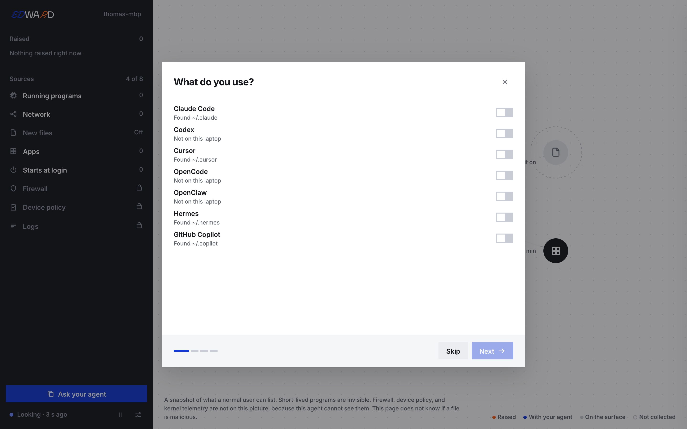
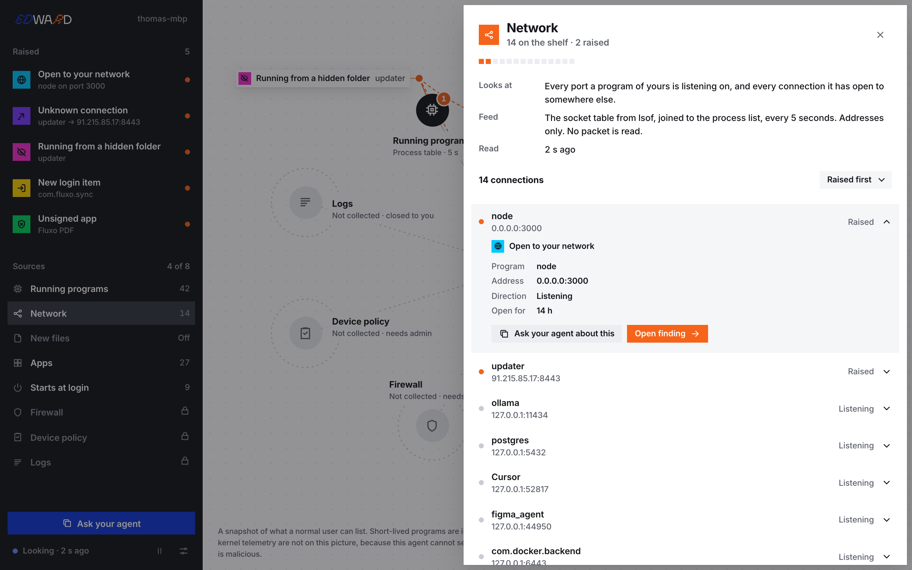

# EDwaRd

<p align="center">
  
</p>

EDwaRd is a local attack-surface picture of this Mac for you and your coding agent. One Go process, running as you, lists what you can already see: processes, listeners, installed apps, and startup items. It writes those facts to a JSON store, serves a page at [http://127.0.0.1:43393](http://127.0.0.1:43393), and your agent reads that store when you ask what looks sketchy.

It is not an antivirus. It has no kernel sensor, no signatures, no blocking, and no cloud. After install it makes no outbound connection. A callout is not a malware verdict.

**v1 is macOS only.** You build from this repo on the Mac that will run it. There is no downloadable binary and no Linux or Windows installer in this build.

## Install

### What you need

| Tool | Used for |
| --- | --- |
| macOS | Runtime and LaunchAgent |
| Git | Clone this repo |
| Go | Build `EDwaRd.app` |
| Node.js + npm | Build the page into the app |
| make | `make mock` and `make app` |

Xcode Command Line Tools are enough for `codesign` (Homebrew's `go` install usually pulls them in). No sudo. No account. No token.

### Steps

1. Clone the repo to this Mac and enter it:

```bash
git clone https://github.com/LlamzonAmazon/edward.git
cd edward
```

If you already have a checkout, `cd` into that directory (the one that contains `install.sh`, `Makefile`, and `mock/`).

2. Build the page, build the app, then install:

```bash
make mock && make app && sh install.sh
```

| Command | What it does |
| --- | --- |
| `make mock` | Installs page dependencies and builds `mock/dist` |
| `make app` | Embeds the page, compiles the Go binary, writes `./EDwaRd.app`, ad-hoc codesigns it |
| `sh install.sh` | Copies the app to `~/Library/Application Support/EDwaRd`, writes LaunchAgent `com.edward.agent`, links `~/.local/bin/edward`, starts the process, opens the page |

3. Confirm the page loads: [http://127.0.0.1:43393](http://127.0.0.1:43393).

If that port is already taken, install stops. It does not pick another port.

Read [install.sh](install.sh) before you run it if you want the exact file paths.

### After install

The first-run page can write a skill for the agents you pick (Cursor, Claude Code, Codex, OpenClaw). Default is to ask first. Skip leaves the page working and writes no agent file.

<p align="center">
  
</p>

If you accept, it may write:

- Cursor: `~/.cursor/skills/edward/SKILL.md` only
- Claude Code: `~/.claude/CLAUDE.md` (sentinel block) and `~/.claude/skills/edward/SKILL.md` <!-- repo-leak:ok EDwaRd skill install path -->
- Codex: `~/.codex/AGENTS.md` (sentinel block) and `~/.codex/skills/edward/SKILL.md`
- OpenClaw: `~/.openclaw/skills/edward/SKILL.md` only

It does not write project `CLAUDE.md`, project `AGENTS.md`, or `.cursor/rules`.

### Reinstall after a code change

From the same repo directory:

```bash
make mock && make app && sh install.sh
```

`install.sh` replaces the app and restarts the LaunchAgent.

### Remote Mac with no browser

SSH tunnel, then open the page on your local browser:

```bash
ssh -L 43393:127.0.0.1:43393 user@host
```

## What you see

<p align="center">
  
</p>

Eight sources around the host. Each hub shows how many items were collected. The graph draws raised and asked findings as callouts. Open a hub for the full list; that list is still in the store.

Drag to pan. Scroll to pan. Pinch, or Ctrl/Cmd and scroll, to zoom. Double-click empty space to reset.

<p align="center">
  
</p>

Each callout has two readings: why it might matter, and why it might be fine. You decide. Clear it, ask an agent about it, or leave it raised.

<p align="center">
  
</p>

One example: `node` listening on `0.0.0.0:3000` for 14 hours, started from Terminal.

- Might matter: anything on this network can try to connect. You may have meant this only for this machine.
- Might be fine: a common way to run a dev server and then forget it.

## How it works

Collectors run on a timer, as you, with fixed argument lists and timeouts. No shell. Command lines are redacted before they are stored. Processes are grouped by name and path, so twenty copies of the same binary are one row.

A six-rule playbook in Go evaluates each snapshot. The same snapshot produces the same findings.

1. Open to your network: listening on an address that is not loopback.
2. Unknown connection: outbound to a raw IP, on a port other than 22, 53, 80, or 443.
3. Running from a hidden folder: a path segment that starts with `.`.
4. Unsigned app: a `.app` bundle that `codesign` reports as unsigned or ad-hoc.
5. New login item: a startup item that was not on the first successful baseline.
6. Disguised file: a name with two extensions whose last one looks executable, and that was not on the first successful files baseline.

The page polls `GET /api/store`. It does not scan the machine. Until you ask, the agent is told only that EDwaRd exists, that the page is on port 43393, and where the skill is. When you ask something like "anything sketchy on my laptop?", the agent reads the store and answers with what EDwaRd raised.

## What it collects

| Source | When | What |
| --- | --- | --- |
| Running programs | every few seconds | name, path, parent, uptime, for this user |
| Network | a short interval | TCP/UDP listeners and outbound sockets |
| Apps | every 10 minutes | `/Applications`, `~/Applications`, Homebrew; version and signature |
| Starts at login | every 10 minutes | user LaunchAgents and login items |
| New files | every minute, off by default | names, sizes, times in Downloads, Desktop, and `/tmp` |

Firewall, device policy, and logs stay empty on this picture. This agent cannot see them.

Never collected: environment variables, SSH private keys, keychains, browser profiles, mail, documents, password-manager vaults, `/etc/shadow`, packet contents, kernel telemetry.

## Pause, turn off, delete

| Action | What it does | How |
| --- | --- | --- |
| Pause looking | Collectors stop. Program stays running. | Settings, or Looking / Paused in the sidebar |
| Turn off | Program quits. Does not start at login. Store and skills stay. | Settings → Turn off EDwaRd |
| Delete from this Mac | Removes program, store, login item, PATH link, and EDwaRd skill files | Settings → Delete EDwaRd from this Mac, or `sh uninstall.sh` from the repo directory |

Your agent has the same three options in its skill. Ask it to pause, turn off, or delete EDwaRd and it should list them before acting.

```bash
cd /path/to/edward
sh uninstall.sh
```

Read [uninstall.sh](uninstall.sh) first. Uninstall stops EDwaRd's process by binary path, removes the LaunchAgent and plist, deletes `~/Library/Application Support/EDwaRd` (the store and notes), removes `~/.local/bin/edward`, removes the sentinel blocks from `~/.claude/CLAUDE.md` and `~/.codex/AGENTS.md` only, and deletes the `edward` skill directories. It finishes with a sweep and verifies each path is gone (exit 1 if anything remains). Delete from the page does the same cleanup. Running uninstall again succeeds. <!-- repo-leak:ok EDwaRd uninstall paths -->

It does not touch project files, other skills, other LaunchAgents, the firewall, chat transcripts, or macOS privacy grants.

Check the machine is clean:

```bash
launchctl print "gui/$(id -u)/com.edward.agent"
test ! -e ~/Library/LaunchAgents/com.edward.agent.plist
test ! -e "$HOME/Library/Application Support/EDwaRd"
test ! -e ~/.local/bin/edward
test ! -d ~/.cursor/skills/edward
test ! -d ~/.claude/skills/edward  # repo-leak:ok EDwaRd skill path
test ! -d ~/.codex/skills/edward
test ! -d ~/.openclaw/skills/edward
grep -n "edward:start\|edward:end" ~/.claude/CLAUDE.md ~/.codex/AGENTS.md  # repo-leak:ok EDwaRd sentinel
curl -sf --max-time 2 http://127.0.0.1:43393/ ; echo "page exit $?"
lsof -nP -iTCP:43393 -sTCP:LISTEN
```

`launchctl print` does not find the service. `grep` prints nothing. `curl` fails to connect. `lsof` prints nothing, or it prints a program that is not EDwaRd.

## License

The license is not chosen yet.

## In this repo

| Path | Role |
| --- | --- |
| `internal/` | Collector, redaction, playbook, store, localhost server |
| `schema/store.schema.json` | Store schema |
| `mock/` | Page |
| `skill/edward/SKILL.md` | Skill template |
| `install/` | User LaunchAgent |
| `media/mock/` | Fixture screenshots for this README |
